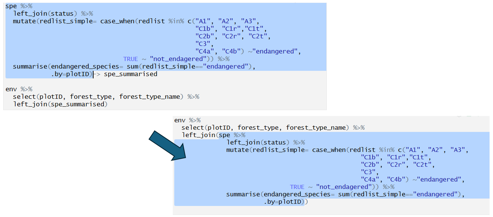

In this chapter, we will practice how to combine several individual steps into elegant pipelines, and we will also use so-called nested pipelines. We will even prepare pipelines from reading the file to writing the output. We will check possible drawbacks with the use of group_by in long pipelines. In addition, we will practise the n_distinct function.

First, upload the following libraries

```{r}
#| warning: false
library(tidyverse)
library(readxl)
library(janitor)
```

We will now return to the forest understory data we already know. Import the data into your environment and check the structure of the datasets. First, the header data and measured variables about the environment "env", and species data"spe", together with data about some plant characteristics "traits", such as plant height, or species "status" , i.e. information if the species is native or alien, and how endangered it is.

```{r}
env <- read_csv("data/forest_understory/Axmanova-Forest-env.csv") 
spe <- read_csv("data/forest_understory/Axmanova-Forest-spe.csv")
status <- read_csv("data/turboveg_to_R/status.csv")
traits <- read_csv("data/forest_understory/traits.csv") 
```

After checking the data, I am not happy about the different fonts and different names used for the same things - Species, species and taxon are used in different files for the same information. Therefore, I decided to upload the data once again using the clean names function and renaming some of the columns.

First, the header and measured data = env data:

```{r}
env <- read_csv("data/forest_understory/Axmanova-Forest-env.csv") %>% 
  clean_names() %>% 
  rename(plotID=releve_nr, pH=p_h_k_cl)

env
```

Now, the species data and species characteristics:

```{r}
spe <- read_csv("data/forest_understory/Axmanova-Forest-spe.csv") %>% 
 clean_names() %>% rename(plotID=releve_nr)
spe
```

```{r}
status <- read_csv("data/turboveg_to_R/status.csv") %>% clean_names()
status
```

```{r}
traits <- read_csv("data/forest_understory/traits.csv") %>% 
  clean_names() %>% rename(species=taxon)
traits
```

Imagine we want to know something about our forest types - what is their overall species richness? Are there some types more rich compared to the others? What about endangered species- how frequent are they, and what is their relative share in individual forest types? In contrast, what is the relative share of alien plants in each type? Are some of them more prone to invasion? We already know how to do that step by step, but we will try different tips to make our workflow more effective.

## 10.1 Nested pipelines

A simple example of the use of nested pipelines is below. Imagine I have a species file, and I want to summarise mean plant height, not in individual plots but in the group of plots from the same vegetation type. The first step is to join the trait file with plant heights, but I also do not have information about the vegetation type in the species file. I do not need anything else from the env file, so I append just a relevant part of the env file by selecting two variables: *plotID,* which is the key to match the files, and *forest_type_name*, which is the one I need for the comparison I want to do.

```{r}
spe %>%    
  filter(layer=="6") %>%    
  left_join(traits) %>%    
  left_join(env %>%                
              select(plotID, forest_type_name)) %>%   
  summarise(mean_plant_height= mean(height, na.rm=TRUE),.by=forest_type_name)   
```

Here, the **nested part** is where we apply the `select` function to the env file. You can also notice it by the different alignment of the text. So, before joining the env file, we apply to it the rest of the steps which are after the corresponding pipe.

```{r}
env %>% select(plotID, forest_type_name)
```

Now we will examine the use of a more complicated nested pipeline. First, let´s use the step-by-step process to prepare a summary of how many endangered species are in the plots. In the species file, the information about status is not directly available, so we have to join it first.

We can see that in the status file, this information is in the "redlist" variable, and the categories are variants of A (extinct) and C1, C2, C3 and C4 (with descending threat from 1 to 4).

```{r}
names(spe)
names(status)
status %>% count(redlist) %>% view()
```

We can therefore filter just those species that are in some of the redlist categories and count them. However, we have this information in a separate file only, and if we want to merge it into the env file, we have to save it and join it in another step.

```{r}
spe %>% 
  left_join(status) %>% 
  filter(!is.na(redlist)) %>% 
  group_by(plotID) %>% 
  count(name="endangered_species")
```

Moreover, there is another problem. Do you know what? If there is a plot with no endangered species, it is not in the final file, and if we append it to the env file, the resulting variable has NAs in some rows instead of zero. See the output below.

```{r}
spe %>% 
  left_join(status) %>% 
  filter(!is.na(redlist)) %>% 
  group_by(plotID) %>% 
  count(name="endangered_species")-> spe_summarised

env %>% 
  select(plotID, forest_type, forest_type_name) %>% 
  left_join(spe_summarised)
```

So we should use a more sofisticated summarise instead of count only.

```{r}
spe %>% 
  left_join(status) %>% 
  mutate(redlist_simple= case_when(is.na(redlist) ~ "not endangered", 
                                   TRUE ~ "endangered")) %>% 
  summarise(endangered_species= sum(redlist_simple=="endangered"),
            .by=plotID)-> spe_summarised

env %>% 
  select(plotID, forest_type, forest_type_name) %>% 
  left_join(spe_summarised)
```

In case we want to select only some categories as endangered, we need to list those relevant. Below, I selected all categories, but some people might be interested only in the more threatened categories e. g. C1-C3. Still, we use two steps.

```{r}
spe %>% 
  left_join(status) %>% 
  mutate(redlist_simple= case_when(redlist %in% c("A1", "A2", "A3",
                                                  "C1b", "C1r","C1t",
                                                  "C2b", "C2r", "C2t",
                                                  "C3",
                                                  "C4a", "C4b") ~"endangered",
                               TRUE ~ "not_endagered")) %>% 
  summarise(endangered_species= sum(redlist_simple=="endangered"), 
            .by=plotID)-> spe_summarised

env %>% 
  select(plotID, forest_type, forest_type_name) %>% 
  left_join(spe_summarised)
```

Although this already works well, we created intermediate objects that we do not really need. Let's make all the steps with the use of **nested pipes**

```{r}
env %>% 
  select(plotID, forest_type, forest_type_name) %>% 
  left_join(spe %>% 
              left_join(status) %>% 
              mutate(redlist_simple= case_when(redlist %in% c("A1", "A2", "A3",
                                                  "C1b", "C1r","C1t",
                                                  "C2b", "C2r", "C2t",
                                                  "C3",
                                                  "C4a", "C4b") ~"endangered",
                               TRUE ~ "not_endagered")) %>% 
              summarise(endangered_species= sum(redlist_simple=="endangered"), 
                        .by=plotID))

```

What happened is shown below. In the first code chunk, we used a step-by-step approach and the shaded part was used to create a separate object. In the second approach, the same was implemented as a nested pipeline. In such a case, we usually first test the outcome of the nested pipeline (e.g. by sending it to the console step by step, or by writing it separately) and only after that, we combine the chunks together with the main pipeline.



In case there are more complicated steps, you might still prefer to use intermediate objects, and it is OK if it works for you. Still, you can give it a try at least with the simple things :-)

## 10.2 Species richness with n_distinct

Let´s play a bit with the nested pipelines. Below, we are calculating the species richness in each plot, considering only unique species names. What is the disadvantage of the approach we used?

```{r}
names(spe)

spe %>%
  group_by(plotID) %>%
  distinct(species) %>% 
  count (name="species_richness") -> spe_richness

spe_richness
```

To get this result, we can preferably use the **n_distinct function**, which combines two steps: distinct and count of grouped variables. If we use the .by in the function itself, we have the advantage that the data are not grouped further.

```{r}
spe %>%
  summarise(species_richness = n_distinct(species), 
                         .by = plotID)-> spe_richness

spe_richness
```

In both examples, we prepared intermediate objects and if we want to have this information in the env file, we have to use join functions to add it. So the next step is to use left_join (I selected from the env file just a few variables to make it easier to see the result).

```{r}
env %>% 
  left_join(spe_richness) %>% 
  select (plotID, forest_type, forest_type_name, species_richness)

```

Note that if we want to keep this information for later, we also have to save it as another object or overwrite the file.

```{r}
env %>% 
  left_join(spe_richness) %>% 
  select (plotID, forest_type, forest_type_name, species_richness) ->env_new
```

Again, all this can be done in a more elegant pipeline. We would use the env file and append summarised information directly from a nested pipeline based on spe data. It would look like this:

```{r}
env %>% 
  select (plotID, forest_type, forest_type_name) %>% 
  left_join(spe %>%
               summarise(species_richness = n_distinct(species), 
                         .by = plotID))

```

## 10.3 Group and ungroup -what does it mean and how it matters

We already worked with group_by, especially for mutate and summarise functions. However, with long or nested pipelines, we should think more deeply about how we use the grouping variable.

Imagine a situation where I want to calculate the mean species richness in each forest type. First, I will use n_distinct to calculate species richness in each plot, and then I will calculate the mean for the forest type. This involves two different grouping variables.

In the first example, I would use explicit **ungroup ()** after the first grouping to

```{r}
spe %>% 
  group_by(plotID) %>% 
  summarise(species_richness=n_distinct(species)) %>% 
  ungroup() %>% 
  left_join (env %>% 
               select(plotID, forest_type, forest_type_name)) %>% 
  group_by(forest_type_name) %>% 
  summarise(mean_richness =mean(species_richness))
```

In this particular example, even if you forget to use ungroup, it should actually work correctly. But only because I did apply **the second grouping** correctly, which **automatically removes the previous grouping.**

```{r}
spe %>% 
  group_by(plotID) %>% 
  summarise(species_richness=n_distinct(species)) %>% 
  left_join (env %>% 
               select(plotID, forest_type, forest_type_name)) %>% 
  group_by(forest_type_name) %>% 
  summarise(mean_richness =mean(species_richness))
```

**If I forget,** the result would be different. Either I forget to specify the second grouping, and there is also no ungroup, so **the first grouping holds till the end** of the pipeline.

```{r}
spe %>% 
  group_by(plotID) %>% 
  summarise(species_richness=n_distinct(species)) %>% 
  left_join (env %>% 
               select(plotID, forest_type, forest_type_name)) %>% 
  summarise(mean_richness =mean(species_richness))

```

**Or I forgot** to use the second grouping, **but I remember to use ungroup**. What happened here? I calculate the mean from the whole dataset.

```{r}
spe %>% 
  group_by(plotID) %>% 
  summarise(species_richness=n_distinct(species)) %>% 
  ungroup() %>% 
  left_join (env %>% 
               select(plotID, forest_type, forest_type_name)) %>% 
  summarise(mean_richness =mean(species_richness))

```

**Mutate vs. summarise.** I can still make a bit more mess. If I use mutate incorrectly, as in the example below, the number of rows is not reduced as with summarise, and the species_richness of the plot is repeated in each row. The result is therefore affected by the number of species=rows in each plot and is simply wrong.

```{r}

spe %>% 
  group_by(plotID) %>% 
  mutate(species_richness=n_distinct(species)) %>% 
  ungroup() %>% 
left_join (env %>% 
               select(plotID, forest_type, forest_type_name)) %>% 
  group_by(forest_type_name) %>% 
  summarise(mean_richness =mean(species_richness))
```

On the other hand, sometimes I want to keep all rows and calculate different characteristics based on the original data, which would not be possible with summarise.

**Remember, to be safest**, you should preferably use the **.by** in the function itself. This means the grouping applies only in the relevant part and is no longer active for the rest of the pipeline.

```{r}
spe %>%
  summarise(species_richness = n_distinct(species),
            .by = plotID) %>% 
  left_join(env %>% 
              select(plotID, forest_type, forest_type_name)) %>% 
  summarise(mean_richness = mean(species_richness),
            .by = forest_type_name)
```

**\*Using groups before introduction of .by**. The option to use .by is not that old compared to stand-alone group_by, which has a longer tradition but also many cons. If you use more grouping variables within group_by, after summarise, the last one is removed by default. If you have two or more, it may change things a lot. Therefore, you may use the `groups` argument to adjust the steps. Either "keep" to keep the same grouping after the first summarise. In contrast, if you do not want to keep any grouping variable further, the other option is to use "drop", which removes grouping from the result. See further reading for more details.

```{r}
spe %>% 
  left_join(env %>% 
              select(plotID,  forest_type_name)) %>% 
  group_by(forest_type_name, plotID) %>% 
  summarise(
    species_richness = n_distinct(species),
    .groups = "keep") %>% 
  mutate(species_rich = species_richness > 30) %>% 
  group_by(forest_type_name) %>% 
  summarise(
    n_plots = n(),
    n_rich_plots = sum(species_rich),
    percentage_rich_plots = n_rich_plots/n_plots*100,
    .groups = "drop")
```

A safe way of the same would be like this:

```{r}
spe %>% 
  left_join(env %>% 
              select(plotID, forest_type_name)) %>% 
  summarise(species_richness = n_distinct(species),
    .by = c(forest_type_name, plotID)) %>% 
  mutate(species_rich = species_richness > 30) %>% 
  summarise(n_plots = n(),
    n_rich_plots = sum(species_rich),
    percentage_rich_plots = n_rich_plots / n_plots * 100,
    .by = forest_type_name)
```

## 10.4 Read and plot/write in one pipeline

The advantage of ggplot is that it works in a similar way to pipelines. Therefore, we can start with adjusting the data and continue with ggplot. The only difference is that you no longer specify which data you should use, and you switch from pipes "%\>%" or "\|\>" to the symbol used in the ggplot logic, which is "+". In the extreme case, you do not even need to name the data you are reading, and you can produce the plot directly.

```{r}
read_csv("https://raw.githubusercontent.com/weecology/portal-teachingdb/master/combined.csv") %>% 
  filter(taxa == 'Rodent') %>% 
  count(plot_id, plot_type, year) %>% 
  ggplot(aes(x = year, y = n, 
             color = plot_type, group = plot_id)) +
  geom_line() +
  theme_bw() +
  labs(x = 'Year', y = 'Number of individuals', color = 'Plot type')
```

Other option is that I want to prepare data in some specific format, subset it, rename etc. And I actually prefer to do this from the beginning. One option is to adjust the data and save it to an intermediate object.

```{r}
#import the data
rats <-read_csv("https://raw.githubusercontent.com/weecology/portal-teachingdb/master/combined.csv")

#use different ways to check the data
names(rats)
rats %>% count(taxa)
rats %>% count(year)

#prepare subset
rodents<- rats %>% 
  filter(taxa=="Rodent" & year >= 1980) %>%
  filter(!species== "sp.") %>% 
  unite("species_name", genus,species, na.rm = T) 

rodents
  
```

Another option is to save the subset and read it anytime we need it, which is a good practice. Next time, you will just import the adjusted data and skip the long pipeline in the beginning.

```{r}
#| eval: false
rats %>% 
  filter(taxa=="Rodent" & year >= 1980) %>%
  filter(!species== "sp.") %>% 
  unite("species_name", genus,species, na.rm = T) %>% 
  write_excel_csv("data/rats/rodents.csv")
  
```

## 10.5 Practise reading the pipelines

We use the forest dataset and calculate the relative share of alien species in the forest types. Alien species are those that have an origin category either as "arch"= archaeophytes, i.e. plants introduced in the deep history or "neo" = neophytes, i.e. plants introduced after the discovery of America and the subsequent start of globalisation. Other species are native (consider NAs as native as well). Train a bit and read step by step what we do below:

```{r}
spe %>% 
  left_join(env %>% select(plotID, forest_type_name)) %>% 
  left_join(status) %>% 
  distinct(forest_type_name, plotID, species, origin) %>% 
  mutate(alien = origin %in% c("arch", "neo")) %>% 
  summarise(species_richness = n_distinct(species),
    alien_richness = sum(alien),
    .by = c(forest_type_name, plotID)) %>% 
  summarise(alien_perc = mean(alien_richness / species_richness) * 100,
    .by = forest_type_name) %>% 
  arrange(desc(alien_perc))
```

We always have more alternatives to do the same thing. What is the difference in the approach below?

```{r}
spe %>% 
  left_join(env %>% select(plotID, forest_type_name)) %>% 
  left_join(status) %>% 
  mutate(status_simple = case_when(origin %in% c("arch", "neo") ~ "alien",
                                   TRUE ~ "native")) %>% 
  summarise(species_richness = n_distinct(species),
    aliens = n_distinct(species[status_simple == "alien"]),
    .by = c(forest_type_name, plotID)) %>% 
  summarise(alien_perc = mean(aliens/species_richness) * 100,
    .by = forest_type_name) %>% 
  arrange(desc(alien_perc))

```

Do you know what would happen if I skip forest_type_name from the first .by and use only plotID?

Describe step by step what is done below.

```{r}
spe %>% 
  left_join(env %>% select(plotID, forest_type_name)) %>% 
  left_join(status) %>% 
  distinct(forest_type_name, plotID, species, origin) %>% 
  mutate(alien = origin %in% c("arch", "neo")) %>% 
  summarise(
    species_richness = n_distinct(species),
    aliens = sum(alien),
    .by = c(forest_type_name, plotID)
  ) %>% 
  summarise(
    alien_perc = mean(aliens / species_richness) * 100,
    .by = forest_type_name
  ) %>% 
  ggplot(aes(x = reorder(forest_type_name, alien_perc),
             y = alien_perc)) +
  geom_col(fill = "darkorange4") +
  coord_flip() +
  labs(
    x = "Forest type",
    y = "Alien species (%)",
    title = "Proportion of alien species across forest types"
  ) +
  theme_minimal()
```

And now?

```{r}
spe %>% 
  left_join(env %>% select(plotID, forest_type_name)) %>% 
  left_join(status) %>% 
  mutate(origin_simple = case_when(
    origin %in% c("arch", "neo") ~ "Alien",
    TRUE ~ "Native")) %>% 
  summarise(
    species_richness = n_distinct(species),
    .by = c(forest_type_name, plotID, origin_simple)) %>% 
  
  mutate(forest_type_name = factor(forest_type_name,
                                   levels = c("alluvial forest", 
                                              "ravine forest", 
                                              "oak hornbeam forest", 
                                              "oak forest"))) %>% 
  ggplot(aes(x = forest_type_name, 
             y = species_richness, 
             fill = origin_simple)) +
  geom_boxplot(position = position_dodge()) +
  labs(
    x = "Forest type",
    y = "Species richness",
    fill = "Species origin"
  ) +
  theme_bw()
```

## 10.6 Exercises

<!-- just a few exercises? e.g. elton_birds -  available in the package "traitdata" install and use data<-data(elton_birds) -->

## 10.7 Further reading

<https://dplyr.tidyverse.org/articles/grouping.html>

<https://r-statistics.co/dplyr-group-by-summarise.html>

Nice summary about advantages of .by

<https://tidyverse.org/blog/2023/02/dplyr-1-1-0-per-operation-grouping/>

<!--calculate relative share of some group of plants / add info on status or threatened status / calculate total cover in plot and cover of the species classified as alien, or redlist - either here or chapter 10   -->

<!-- function on plots - something as I have in the alien maps  -->

<!--add mutate ifelse with other symbols  -->

<!--pivot with values_drop_na  -->

<!--regex? species names?  -->
