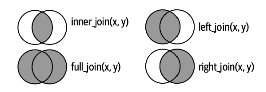
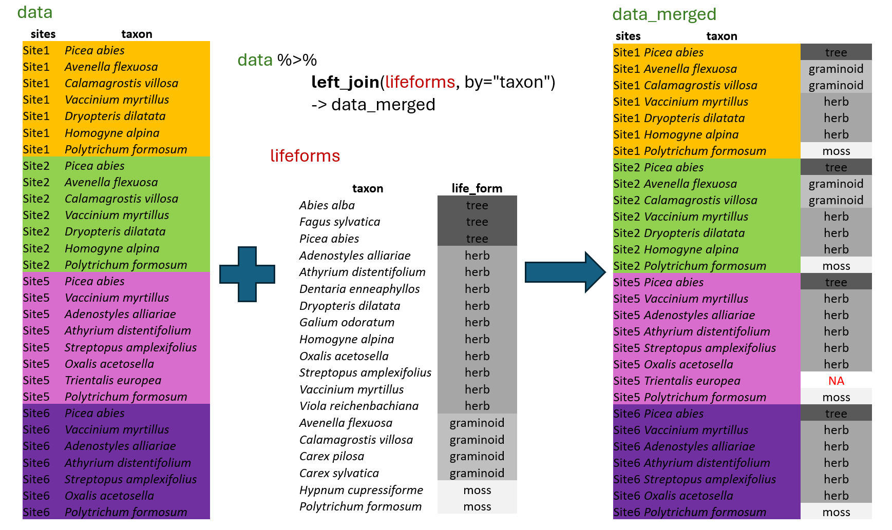
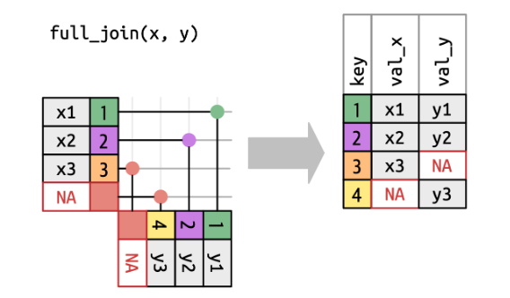
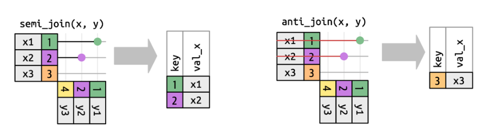
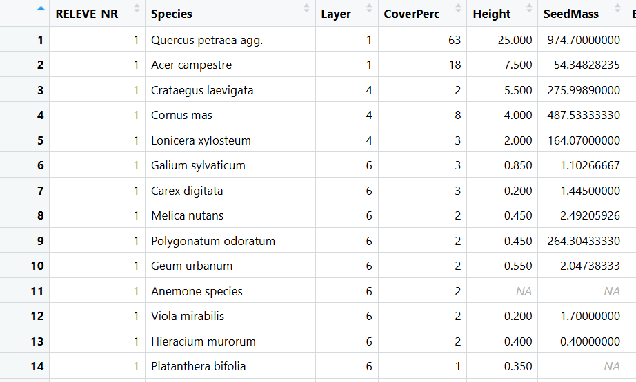
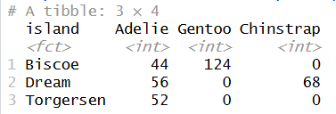

In this chapter, we will learn how to merge information from another dataset (using `left_join()`, `full_join()`) and how to filter our data based on another dataset (`semi_join()`, `anti_join()`). We will also use our skills from the previous chapter to calculate various statistics about our data, such as community means and community-weighted means of selected traits or indicator values (using `left_join()`, `group_by()`, and `summarise()`).

In the picture below, you can see simple visualisation of two datasets joined by different approaches. The resulting dataset is depicted in grey.



Credits: <https://r4ds.hadley.nz/joins.html>

## 5.1 Matching selected information with `left_join()`

In most cases, the data you need for analyses is not organised in one file, but rather in multiple files. For example, we have measured characteristics, known as traits, for each species in the region, and we have species lists for all the sites. To calculate the mean values of selected traits for each site, we must first append the information to individual records. For this, we will use the function called `left_join()`, which belongs to the group of **mutating joins** available in the `tidyverse` package `dplyr`.

This function will automatically look for columns with exactly matching names, or we can specify the corresponding variables directly using the `by` argument. It will append all the columns available in the second "lifeforms" dataset, but only for rows where there is an exact match. Although we have information for other species, such as *Abies alba* or *Carex sylvatica*, these do not have matching rows in the first dataset named "data", and the information will therefore not be used. This means that `left_join()` is only selecting rows that are present in the first dataset. If the information is missing in the matching file, for example, if there is no information for *Trientalis europaea* in the lifeforms dataset, the resulting file will contain NA.

Let's train a bit. Start a new script for this chapter again.

```{r}
#| warning: false
library(tidyverse)
library(readxl)
library(janitor)
```

We will import the data from the Forest understory again.

```{r}
spe <- read_csv("data/forest_understory/Axmanova-Forest-spe.csv")
```

We will also import data with some traits, such as plant height and Ellenberg-type indicator values, which indicate demands on environmental factors, including soil reaction, light, and nutrients. Lower values indicate lower demands, meaning that species can tolerate low (acidic) pH levels or low nutrient levels. High values suggest that the species requires or grows in habitats with high (basic) soil reaction and high nutrient availability.

```{r}
traits <- read_csv("data/forest_understory/traits.csv")
```

If we try to merge these two files directly, it does not work. We will get a warning explaining that there are no common variables.

```{r}
#| error: true
spe %>% left_join(traits)
```

So there are more options for what we can do. We check the data and find out that the corresponding/matching information is stored once as 'Species' (in the data) and once as 'Taxon' (in traits).

```{r}
tibble(spe)
```

```{r}
tibble(traits)
```

We can decide to rename the 'Species' column to 'Taxon' and use this column for matching.

```{r}
spe %>% rename(Taxon = Species) %>% 
  left_join(traits, by = "Taxon")
```

Or we can even skip the by argument, as there is only one common matching column.

```{r}
spe %>% rename(Taxon = Species) %>% 
  left_join(traits)
```

We can also skip the `rename()` step and directly say in the `left_join()` function what is matching with what. It will retain 'Species' as the outcome, because that is how we named it in the primary data file.

```{r}
spe %>% left_join(traits, by = c("Species" = "Taxon"))
```

Note that `left_join()` is a great help. However, you should always check before, or know the data well. If you have multiple matching rows, you can create a lot of unwanted mess with `left_join()`. For example, if you do not use a unique ID, but a descriptor such as forest type. Please read the warning messages carefully. :-)

**`*Right_join`** works almost the same as the left_join. You just have to turn the logic. It keeps all the observations in the matching file.

## 5.2 `full_join()` vs. `bind_rows()`

Sometimes it is needed to match both datasets exactly as they are. First, we will look at the full_join. In contrast to `left_join()`, `full_join()` will also add additional rows that appear in the other dataset.



Credits: <https://r4ds.hadley.nz/joins.html>

We will upload the forest env data and make two subsets to train a bit.

```{r}
env <- read_csv("data/forest_understory/Axmanova-Forest-env.csv")
```

In the first subset, we will use only the first two forest types, namely oak and oak-hornbeam forests and the following selection of variables.

```{r}
forest12 <- env %>% filter(ForestType %in% c(1, 2)) %>% 
  select(PlotID = RELEVE_NR, ForestType, ForestTypeName, pH_KCl, Biomass)
```

In the second subset, we will use one forest type shared with the previous subset and two others: oak-hornbeam, ravine, and alluvial forests, with a slightly different selection of variables.

```{r}
forest234 <- env %>% 
  filter(ForestType %in% c(2, 3, 4))%>% 
  select(PlotID = RELEVE_NR, ForestType, ForestTypeName, pH_KCl, Canopy_E3)
```

Now, **`left_join()`** the data and check the preview (use `view()`) to see more of the dataset. We have added the extra information available in the second dataset to our selection of plots and variables in the first dataset, but the number of rows remained the same as it was in the forest1 selection i.e. 44 rows of the oak and oak-hornbeam forest types.

```{r}
forest12 %>% 
  left_join(forest234)
```

In the next step, we will combine both subsets using a **`full_join()`**. What is the output? We will obtain a dataset containing 65 rows and all available information, encompassing all four forest types. However, since Forest type 1 is only present in the first subset, the corresponding rows will include only the information available there (forest type and pH). Type 2 is present in both datasets. Therefore, it will contain all information from both datasets (forest type, pH, biomass, and canopy). Types 3 and 4 will have information only from the second dataset (forest type, pH, canopy). Use `view()` to see the complete merged dataset.

```{r}
forest12 %>% 
  full_join(forest234)
```

Note that the joining worked well, since we had the same names of variables in both datasets. For example, if the soil reaction were called soil_pH in one and pH_KCl in the other dataset, it will treat them as different variables, as you can see below:

```{r}
forest12 %>% 
  rename(soil_pH = pH_KCl) %>% 
  full_join(forest234)
```

\*Tip: if you are merging data from different sources and you get a similar mess, check the function `coalesce()` <https://dplyr.tidyverse.org/reference/coalesce.html>.

```{r}
forest12 %>% 
  rename(soil_pH = pH_KCl) %>% 
  full_join(forest234) %>% 
  mutate(pH=coalesce(soil_pH,pH_KCl)) %>% 
  select(PlotID, pH, soil_pH, pH_KCl) %>% 
  filter(PlotID <5 | PlotID>120)
```

Imagine a situation where data were sampled in different years/months or by different colleagues, or in different regions separately. If these **subsets have exactly the same structure**, we can use the **`bind_rows()`** function to merge them, one below the other.

```{r}
forest1 <- env %>% 
  filter(ForestType == 1) %>% 
  select(PlotID = RELEVE_NR, ForestType, ForestTypeName, pH_KCl, Biomass)

forest2 <- env %>% 
  filter(ForestType == 2)%>% 
  select(PlotID = RELEVE_NR, ForestType, ForestTypeName, pH_KCl, Biomass)
```

Bind and check the whole dataset with `view()`.

```{r}
forest1 %>% 
  bind_rows(forest2)
```

Note that the `rbind()` function in base R works similarly, but less effectively and it is designed for data frames.

```{r}
rm(forest1, forest2, forest12, forest234) #remove unwanted data from the environment
```

## 5.3 \*Inner_join

**`Inner_join`** compares the two files and keeps only rows that are common in both files. Therefore, it is easy to lose information, and we should be careful about this approach. In the example below, I have a dataset with forest types 1, 2 and 3 and information about biomass and another dataset with forest types 2, 3 and 4 and information about pH. In the merged file, inner_join keeps only the common rows with the same key= PlotID. Therefore, the result will include only vegetation types 2 and 3, but with all information available in both files (i.e., biomass and pH).

```{r}
forest123 <- env %>% 
  filter(ForestType %in% c (1,2,3)) %>% 
  select(PlotID = RELEVE_NR, ForestType, ForestTypeName, Biomass)

forest234 <- env %>% 
  filter(ForestType %in% c (2,3,4))%>% 
  select(PlotID = RELEVE_NR, ForestType, ForestTypeName, pH_KCl)

forest<- forest123 %>% inner_join(forest234)
tibble(forest)
```

With the lines below, I remove specified objects that I no longer need from the environment. `rm` is a shortcut for remove.

```{r}
rm(forest, forest123, forest234)
```

## 5.4 Filtering joins

Sometimes we need to filter the data according to another dataset. For example, we have reviewed the environmental file and determined that for a follow-up analysis, we only need the alluvial forest data. Therefore, we filtered rows in the env file.

```{r}
forest4 <- env %>% 
  filter(ForestType == 4)%>%
  select(PlotID = RELEVE_NR,ForestType, ForestTypeName, pH_KCl, Biomass) %>% 
  print()
```

However, we also need to filter the rows in the species data where there is no information about forest types. The only common identifier is the PlotID (i.e. sample/site ID).

```{r}
spe %>% rename(PlotID = RELEVE_NR) %>% 
  semi_join(forest4)
```

With the `distinct()` function, you can check if the IDs are the same.

```{r}
spe %>% rename(PlotID = RELEVE_NR) %>% 
  semi_join(forest4) %>% 
  distinct(PlotID)
```

Sometimes you may need the opposite - to keep only rows/IDs that are not in the other file. For this, you should use the `anti_join()` function. For example, you may want to remove a particular group of species from your list, such as annuals or non-vascular plants (mosses and lichens).



To show you how anti_join works, I will prepare an example of the list of herbs and filter the dataset of traits.

```{r}
herbs <- spe %>% 
  filter(Layer==6) %>% 
  distinct(Species)
```

First, I will filter the dataset of traits to keep only the data for the herbs with `semi_join` i.e. I will keep the same species.

```{r}
traits %>% semi_join(herbs, by=c ("Taxon"= "Species"))
```

Now I will filter the dataset of traits to keep everything except the herbs with `anti_join`. I will keep only the species not in the list of herbs.

```{r}
traits %>% anti_join(herbs, by=c ("Taxon"= "Species"))
```

## 5.5 Community means and community weighted means with `summarise()`

`summarise()` reduces the information to a single value per group, as defined by the `group_by()` function. We also used summarise() with across() to calculate the minimum, mean, median, maximum, or sum of values in the env data. A simple example is below.

```{r}
env %>% 
  group_by(ForestTypeName) %>%
  summarise(meanBiomass = mean(Biomass))
```

Here, we will use joins to add new possibilities for how to use summarise.

`summarise()` is often used for obtaining so-called **community means** or community-weighted means. For example, we have traits for individual species, and we want to calculate a mean for each site and compare it.

```{r}
spe %>% 
  left_join(traits, by = c("Species" = "Taxon")) %>%
  summarise(meanHeight = mean(Height), .by = RELEVE_NR)
```

So far, we have had data with no missing values, but you will most likely encounter situations where there are some NAs. For this, you will need to use the argument **`na.rm = TRUE`**, which indicates that you want to skip the NAs from counting. Otherwise, a single NA would mean that the result will also be NA. The same issue occurred here, so we need to address it.

{fig-align="center" width="554"}

```{r}
spe %>% 
  left_join(traits, by = c("Species" = "Taxon")) %>%
  summarise(meanHeight = mean(Height, na.rm = T), .by = RELEVE_NR)
```

We can also consider using abundance to weight the result. This is called the **community-weighted mean**, and it assigns higher importance to species that are more abundant and lower importance to those that are rare. Here, the abundance is approximated as a percentage cover in the plot.

```{r}
spe %>%
  left_join(traits, by = c("Species" = "Taxon")) %>%
  summarise(meanHeight = mean(Height, na.rm = T),
            meanHeight_weighted = weighted.mean(Height, CoverPerc, na.rm = TRUE),
            .by = RELEVE_NR)
```

You can see that the results are pretty different! Note that we are in a forest, so we now compare the heights of the dominant trees and the smaller, less abundant herbs. Especially for the CWM, it plays a huge role. Therefore, we will now calculate the CWM only for the herb layer (6).

```{r}
spe %>%
  left_join(traits, by = c("Species" = "Taxon")) %>%
  filter(Layer == 6) %>%
  summarise(meanHeight = mean(Height, na.rm = T),
            meanHeight_weighted = weighted.mean(Height, CoverPerc, na.rm = TRUE),
            .by = RELEVE_NR)
  
```

Similarly, we can calculate community means across multiple variables simultaneously. Here, we will try the **Ellenberg-type indicator values** (abbreviated as EIV), which measure species demands for particular factors. The higher the value, the higher the demands or affinity to habitats with higher values of these environmental factors. We will apply them solely based on the presence of species; no weights will be used. Therefore, we do not need to care that much about the differences among layers. However, we will keep each species only once (a list of unique species for each plot), so we will remove information about layers first and use `distinct()`. An alternative is to add `filter(Layer == 6) %>%` if we want to focus on the herb layer only.

```{r}
spe %>%
  left_join(traits, by = c("Species" = "Taxon")) %>%
  select(-c(Layer, CoverPerc)) %>%
  distinct() %>%
  group_by(PlotID=RELEVE_NR) %>%
  summarise(across(starts_with("EIV"), ~mean(.x, na.rm = TRUE)))
```

When you become confident with joins and `summarise()`, you can even do something like this: We are working with env data, but at the same time, we want to use the summarised information from species data. We can calculate it directly in the pipeline without stepping outside, as there is no need to calculate and save intermediate steps separately. We will train this in chapters 10 and 11.

```{r}
env %>%    
  left_join(spe %>%                
              group_by(RELEVE_NR) %>%                
              count(name = "Richness")) %>%   
  select(PlotID = RELEVE_NR, ForestType, ForestTypeName, Richness)
```

## 5.6 Exercises

1\. Prepare a script from this chapter with your notes.

2\. Do a bit more training with **Forest understory** **env data**. Upload the env file called `Axmanova-Forest-env.csv` and create two subsets saved in your environment: *forest1* with variables PlotID = RELEVE_NR, ForestType, ForestTypeName and *forest2* with variables ForestType, pH_KCl, Biomass. Now use `left_join()` to match forest2 to forest1. What happened?

3\. Get back to the **Forest understory** **species file** (`Axmanova-Forest-spe.csv`). In the data, you can see which species occur in the tree layer (=1) \>\> prepare a table where for each plotID you will have in another column a single name of the tree dominant, i.e. the tree with the highest cover (*for simplicity, specify in the `slice_max(n= 1, with_ties = F`*)\>\> What is the most common dominant? In how many plots?

4\. Append this list of dominants to env data \>\> calculate counts of plots with each of the dominant for each forest type \>\> arrange the data. \*Create a table in a wide format of forest types x dominants.

5\. Use **Forest understory species and traits** \>\> calculate community mean and community weighted mean for SeedMass.

6\. Take the file with traits and filter it to contain only values for dominants from the exercise 2.

7\. Upload **Penguins data** by loading the library(palmerpenguins) \>\> check names \>\> calculate mean weight and standard deviation of weight for different penguin species (group_by, summarise). \>\> Do you remember how to visualise the weight data for each species with ggplot?

8\. Stay with Penguins. In Chapter 3.4 / Bar charts, we used a ggplot to visualise how many individuals are on each island and to which species they belong. Now, try to summarise the information into a table format with islands as rows and species as names, where values will be counts of individuals.

{width="231"}

9\. \*Upload the data from the **Lepidoptera** folder "env_MSVejnoha_transposed.csv". First, load the env data and check its structure and assign it to the *lepidoptera_env*. \>\> Check the histogram of the cover of trees across sites \>\> prepare a new variable called tree_shading corresponding to low/medium/high cover of trees (select the thresholds based on the histogram) and save it in the data \>\> filter out the group with only low cover and assign it to *lepidoptera_env_selection* \>\>

Import the species data from the same folder "spe_matrix_MSVejnoha.csv" which contains for each site the list of taxa and corresponding counts of individuals \>\> change it to long format (pivot_longer) \>\> and, using filtering join, filter this data to *lepidoptera_spe_selection*, where you will have only the same sites as in the env selection.

## 5.7 Further reading

Joins - chapter in R for Data Science: <https://r4ds.hadley.nz/joins.html>

Summarise: <https://dplyr.tidyverse.org/reference/summarise.html>

Summarise multiple columns: <https://dplyr.tidyverse.org/reference/summarise_all.html>

<!-- frogID_data <- readr::read_csv('https://raw.githubusercontent.com/rfordatascience/tidytuesday/main/data/2025/2025-09-02/frogID_data.csv') -->

<!-- frog_names <- readr::read_csv('https://raw.githubusercontent.com/rfordatascience/tidytuesday/main/data/2025/2025-09-02/frog_names.csv') -->

<!-- # feederwatch - left_join, filter, maps -->

<!-- # https://github.com/rfordatascience/tidytuesday/blob/main/data/2023/2023-01-10/readme.md -->

<!-- # nps_usa - filtering, maps -->

<!-- # https://github.com/rfordatascience/tidytuesday/blob/main/data/2024/2024-10-08/readme.md -->

<!-- # bird collisions -->

<!-- # https://github.com/rfordatascience/tidytuesday/tree/main/data/2019/2019-04-30 -->

<!-- # numbats <- read_csv('https://raw.githubusercontent.com/rfordatascience/tidytuesday/main/data/2023/2023-03-07/numbats.csv') -->
